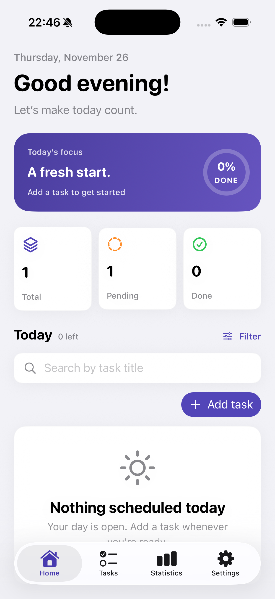
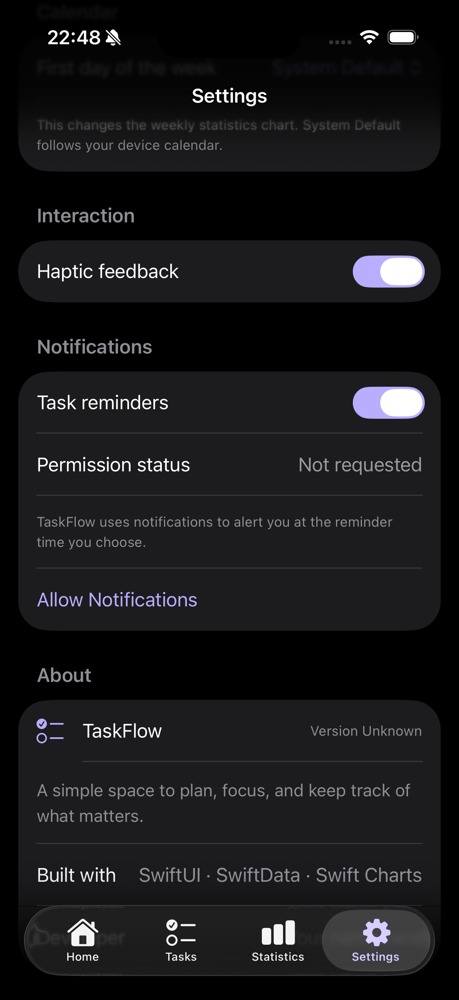
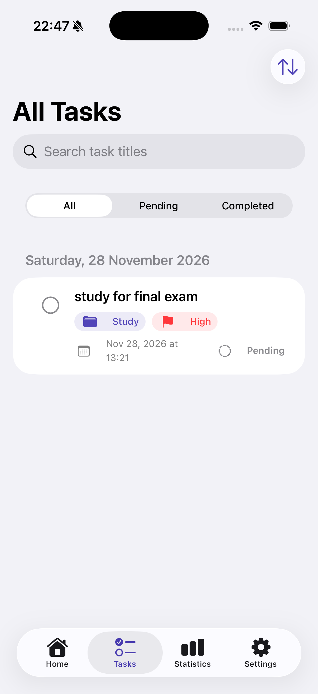
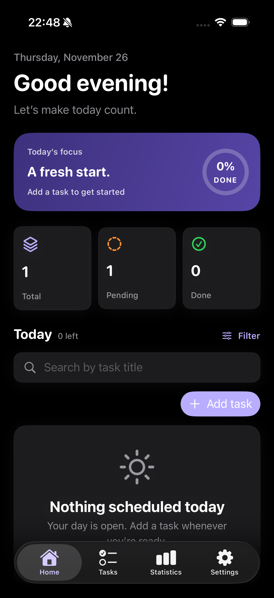
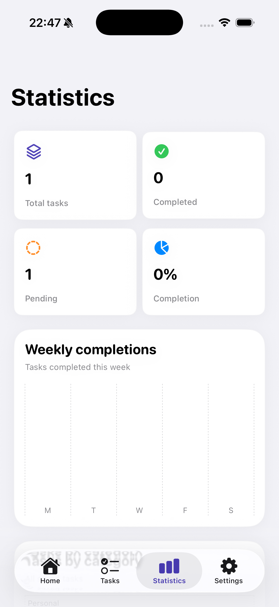
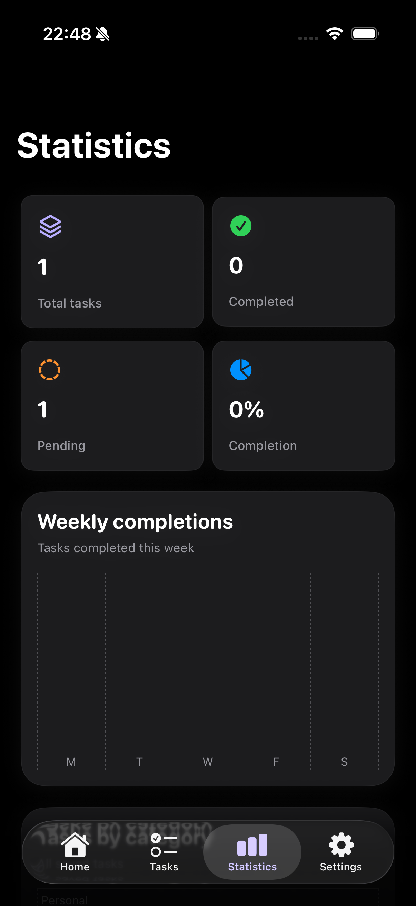
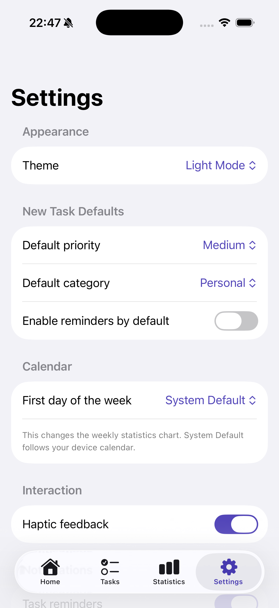
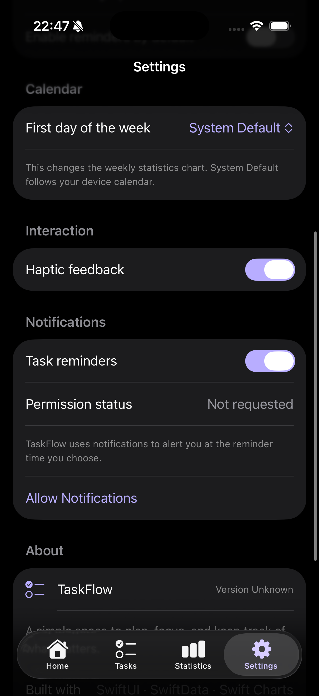
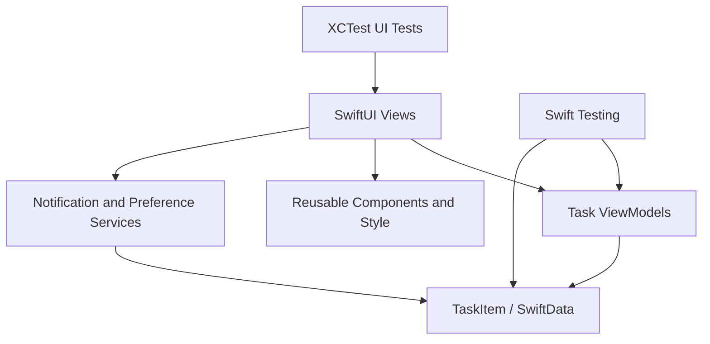

# TaskFlow

TaskFlow is a native iOS task manager built with Swift and SwiftUI. It helps people plan tasks, track progress, and keep reminders and task data on their device.

## Features

- Create, edit, complete, reopen, and delete tasks
- Add descriptions, due dates, categories, and Low/Medium/High priorities
- Schedule local reminders, with notification permission guidance and Settings integration
- Search tasks and filter by status or priority; sort by due date or priority
- View dashboard summaries and weekly/category statistics with Swift Charts
- Choose System, Light, or Dark appearance
- Set defaults for category, priority, and reminders; choose week start; turn haptics on or off
- Persist tasks locally with SwiftData and preferences with UserDefaults
- Import records from TaskFlow's earlier local storage format

## Screenshots

These are real iPhone 17 Pro Simulator captures supplied for the project.

| Screen | Light Mode | Dark Mode |
|---|---|---|
| Home dashboard |  |  |
| All Tasks |  |  |
| Statistics |  |  |
| Settings |  |  |

The New Task form is also captured in [Light Mode](Screenshots/add-task-light.png). A clean Task Details screenshot has not been supplied yet. The simulator captures show sample local tasks; replace them with fresh captures if you later change the interface.

## Technology

| Technology | Use |
|---|---|
| Swift, SwiftUI | App language and interface |
| SwiftData | On-device task persistence |
| MVVM | Separation of task logic and screens |
| Swift Charts | Weekly completion and category charts |
| UserNotifications | Local task reminders |
| Swift Testing | Unit tests |
| XCTest | UI automation |
| Xcode | Build and simulator workflow |

Minimum deployment target: **iOS 17.0**.

## Architecture

The app follows MVVM. SwiftUI views query SwiftData and delegate task operations to view models. Services handle notifications, user preferences, and importing records from the earlier storage format. Shared components and styles keep controls and visual treatment consistent.



## Project structure

```text
Task-manager/
├── README.md
├── .gitignore
├── TaskManager.xcodeproj/
│   └── xcshareddata/xcschemes/TaskManager.xcscheme
├── TaskFlow/
│   ├── App/                 # App entry point, model container, and four-tab root
│   ├── Models/              # SwiftData task model and task enums
│   ├── ViewModels/          # Task operations and statistics calculations
│   ├── Views/
│   │   ├── Home/            # Dashboard
│   │   ├── Tasks/           # Task list, composer, and details
│   │   ├── Statistics/      # Statistics and charts
│   │   └── Settings/        # Preferences, notifications, and About
│   ├── Components/          # Design system and reusable task row
│   └── Services/            # Notifications, preferences, and legacy import
├── TaskManagerTests/        # Swift Testing unit and persistence tests
└── TaskManagerUITests/      # XCTest UI tests
```

## Run locally

1. Install Xcode 15 or later on macOS.
2. Clone the repository:

   ```sh
   git clone https://github.com/leenajilain7/Task-Manager.git
   cd Task-Manager
   ```

3. Open `TaskManager.xcodeproj` in Xcode.
4. Select the shared **TaskManager** scheme and an installed iOS 17 or later simulator.
5. Choose an iPhone simulator destination, then press **Run** (⌘R).

Task records are stored locally. The app does not require a third-party package or account.

## Tests and verification

Most recently verified with a clean Xcode test run on an **iPhone 16 Pro simulator running iOS 18.5**:

- 41 unit tests passed
- 5 UI tests passed
- 46 tests total; 0 failures; 0 skipped

The project deployment target is iOS 17, but an iOS 17 simulator runtime was not installed, so iOS 17 simulator testing has not been performed.

Notification scheduling and cancellation are covered by mock-based tests. **Actual notification delivery has not been manually verified.** Test delivery on a physical iPhone before relying on reminders: allow notifications, schedule a reminder a few minutes ahead, background and force-quit TaskFlow, then check delivery. Repeat after editing a reminder and after completing or deleting its task.

Run tests in Xcode with **Product → Test** (⌘U), or from Terminal:

```sh
xcodebuild test -project TaskManager.xcodeproj -scheme TaskManager \
  -destination 'platform=iOS Simulator,name=iPhone 16 Pro,OS=18.5'
```

## Future improvements

- Add real-device notification delivery checks and broader accessibility testing
- Add optional task synchronization or backup
- Add more task insights and configurable dashboard summaries
- Add localization and additional date-format preferences
- Add curated, real-device and simulator screenshots for the screens above

## Repository notes

There are no third-party package dependencies. `.gitignore` excludes Xcode user-specific settings, local build output, DerivedData, and macOS `.DS_Store` files. Do not commit credentials, local databases, or personal Xcode workspace state.
